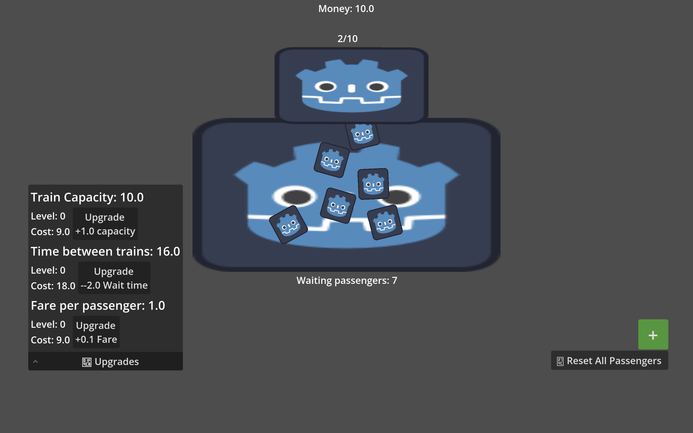

# Rail Clicker
Made for HackClub Terra (Week 4)

# Description
- Sort of like a combination of an auto clicker game and a tycoon
## Features
- Trains!
  - A train will come every so often and pick up passengers
- Passengers!
  - Use the plus icon to add passengers to the platform
  - When the train comes, they will pathfind to board the train
- Economy!
  - Earn money by completing journeys
  - Upgrade the train capacity, wait time between trains, and fare to earn even more money  

# How to demo
[Run in browser through itch.io](https://iamagoodperson.itch.io/rail-clicker)

# Additional info
made with Godot  
This is my first godot game so it probably isnt very polished...